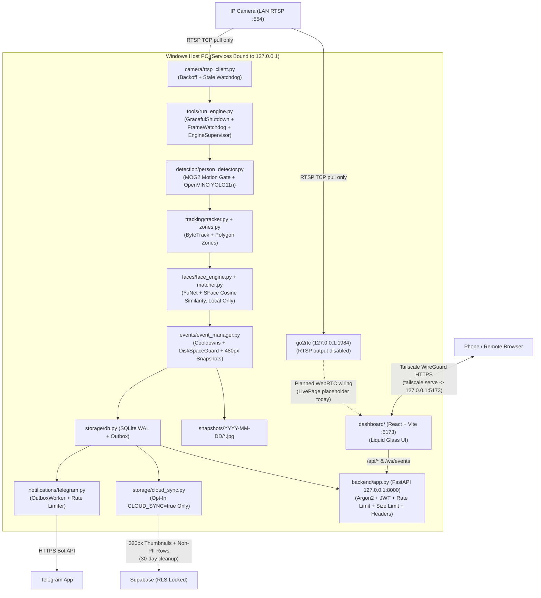
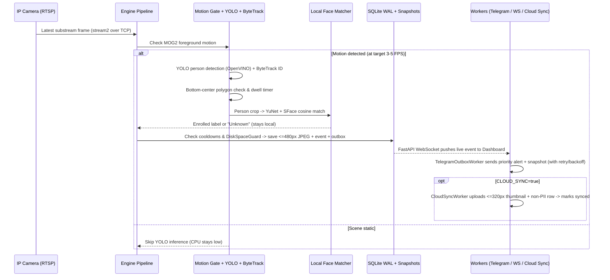

# Vision Surveillance (Local-First Windows CPU Edition)

A privacy-first, local-first home surveillance system engineered for a **Windows 10/11 PC (CPU-only / Intel iGPU OpenVINO)**. Raw video, face recognition embeddings, and snapshots stay on your own computer; remote access is private over Tailscale, alerts go to your Telegram bot, and optional off-site event mirroring to Supabase is **disabled by default**.

---

## Architecture Diagram



---

## Data Flow Diagram



---

## System Requirements

- **OS:** Windows 10 or Windows 11 (64-bit)
- **CPU / Memory:** Intel Core i3/i5/i7 (integrated graphics supported via OpenVINO) or compatible x64 CPU, 8 GB+ RAM recommended
- **Python:** Python 3.11+
- **Node.js:** Node.js 20+ and npm 10+ (for the React dashboard)
- **Camera:** RTSP-capable IP camera on your local network providing H.264 `stream1` (main) and `stream2` (substream), or a local `.mp4` test video file
- **Optional Tools:** Tailscale (private mobile HTTPS access), VeraCrypt (at-rest encryption for database & snapshots), `go2rtc.exe` (low-latency WebRTC relay)

---

## Installation

Open **PowerShell** inside the project folder (`vision-surveillance`):

### 1. Python Virtual Environment & Dependencies

```powershell
python -m venv venv
.\venv\Scripts\Activate.ps1
python -m pip install --upgrade pip
pip install torch torchvision --index-url https://download.pytorch.org/whl/cpu
pip install -r requirements.txt
```

### 2. Download Local Face Recognition Models

Downloads official OpenCV Zoo YuNet & SFace ONNX models into `models/` (stays 100% local):

```powershell
python tools\download_models.py
```

### 3. Install & Build the Frontend Dashboard

```powershell
cd dashboard
npm install
npm run build
cd ..
```

---

## Configuration (`.env`)

Create your local `.env` file from `.env.example` (never commit `.env` — it is ignored by `.gitignore`):

```powershell
Copy-Item .env.example .env
```

Key values to set in `.env`:

| Variable | Description | Default |
|---|---|---|
| `CAMERA_IP`, `CAMERA_USER`, `CAMERA_PASS` | Local IP camera address & RTSP login (leave empty only if using `CAMERA_SOURCE` video file) | `""` |
| `CAMERA_SOURCE` | Optional path to local `.mp4` test video instead of a live camera | `""` |
| `JWT_SECRET_KEY` | Long random secret for dashboard JWT signing (`python -c "import secrets; print(secrets.token_urlsafe(48))"`) | `""` (required for API) |
| `TELEGRAM_ENABLED`, `TELEGRAM_BOT_TOKEN`, `TELEGRAM_CHAT_ID` | Telegram Bot alerts (keep `TELEGRAM_ENABLED=false` if unused) | `true` / `""` |
| `API_HOST`, `API_PORT` | FastAPI listen address (validated to localhost or Tailscale `100.64.0.0/10`) | `127.0.0.1` / `8000` |
| `CORS_ALLOWED_ORIGINS` | Allowed browser origins (add your `https://<pc>.<tailnet>.ts.net` URL for phone access) | localhost `:3000`, `:5173` |
| `CLOUD_SYNC` | Optional off-site Supabase event/thumbnail mirror (off by default) | `false` |
| `DISK_LOW_WARN_MB`, `DISK_CRITICAL_STOP_MB` | Disk-space warning and snapshot cutoff thresholds | `2048` / `512` |
| `BACKUP_DIR`, `BACKUP_KEEP_COUNT` | Destination folder/drive and retention count for weekly SQLite hot backups | `backups` / `8` |

### Create Owner Login & Draw Detection Zones

1. Create the single owner account for the dashboard (open registration is disabled):
   ```powershell
   python tools\create_owner.py --username admin
   ```
2. Verify camera connection and preview live substream (`q` quits):
   ```powershell
   python tools\camera_check.py
   # Or test with a local video file:
   python tools\camera_check.py --source path\to\video.mp4
   ```
3. Draw restricted polygon zones (`config/zones.json`) via CLI or later in the browser:
   ```powershell
   python tools\draw_zones.py
   ```

---

## Running the System

### Interactive Development / Manual Run (3 Terminals)

1. **Terminal 1 — FastAPI Backend (`127.0.0.1:8000`)**:
   ```powershell
   .\venv\Scripts\Activate.ps1
   python -m backend.app
   ```
2. **Terminal 2 — Dashboard UI (`127.0.0.1:5173`)**:
   ```powershell
   cd dashboard
   npm run preview -- --host 127.0.0.1 --port 5173
   ```
3. **Terminal 3 — Supervised Vision Engine**:
   ```powershell
   .\venv\Scripts\Activate.ps1
   python tools\run_engine.py
   ```
4. **Optional — Local `go2rtc` WebRTC Bridge (`127.0.0.1:1984`, RTSP server disabled)**:
   ```powershell
   python tools\run_go2rtc.py
   ```

Open **`http://127.0.0.1:5173`** in your browser and sign in with the owner credentials you created.

### Unattended Windows Startup & Hardening

- **Auto-start & crash recovery:** `.\tools\service_runner.ps1 -Install -ProjectRoot (Get-Location).Path -BackupDest "E:\VisionBackups"` (see [WINDOWS_RELIABILITY.md](docs/WINDOWS_RELIABILITY.md))
- **Private mobile HTTPS over Tailscale:** `tailscale serve --bg http://127.0.0.1:5173` (see [REMOTE_ACCESS.md](docs/REMOTE_ACCESS.md))
- **Windows Firewall inbound lockdown:** `.\tools\harden_firewall.ps1 -Apply` (run as Administrator)

---

## Further Documentation

- [Family User Guide (Enrollment, Consent & Data Deletion)](docs/FAMILY_USER_GUIDE.md)
- [Safe Remote Access with Tailscale](docs/REMOTE_ACCESS.md)
- [Encrypting Snapshots & Database with VeraCrypt](docs/VERACRYPT_STORAGE.md)
- [Windows Unattended Reliability & Power Settings](docs/WINDOWS_RELIABILITY.md)
- [Optional Supabase Cloud Mirror (Off by Default)](docs/SUPABASE_SYNC.md)
- [Threat Model & Security Acceptance Checklist](docs/THREAT_MODEL.md)
- [Dependency Security Audit Guide](docs/DEPENDENCY_AUDIT.md)
- [Release Checklist, Test Matrix & Known Limitations](docs/RELEASE_CHECKLIST.md)

---

## Troubleshooting

- **Camera fails to connect / high latency:** Confirm `CAMERA_IP`, `CAMERA_USER`, `CAMERA_PASS`, and `CAMERA_SUB_STREAM=stream2` in `.env`, verify `python tools\camera_check.py` connects over RTSP TCP, and check camera H.264 settings on `stream2`.
- **OpenVINO export warning on startup:** `PersonDetector` and `PersonTracker` automatically fall back to PyTorch CPU inference if OpenVINO model export fails. Run `python tools\benchmark.py --source path\to\video.mp4` to measure CPU inference latency.
- **Dashboard shows `401 Unauthorized` or `429 Too Many Requests`:** Wait for the `Retry-After` cooldown (default 5 failed logins / 60s), verify `JWT_SECRET_KEY` is set in `.env`, and confirm the backend is running on `127.0.0.1:8000`.
- **Blocked by CORS when opening via Tailscale on phone:** Add your exact `https://<pc-name>.<tailnet>.ts.net` origin to `CORS_ALLOWED_ORIGINS` in `.env` and restart the FastAPI backend.
- **Snapshots stopped saving:** Check logs for `DiskSpaceGuard [CRITICAL]`. Free up space above `DISK_CRITICAL_STOP_MB` (default 512 MB) or run retention cleanup (`python -c "from config.settings import get_settings; from storage.db import Database; from storage.retention import run_retention; s=get_settings(); db=Database(settings=s); print(run_retention(db, retention_days=s.retention_days, snapshots_dir=s.snapshots_dir)); db.close()"`).
- **VeraCrypt volume won't dismount (`in use`):** Stop `run_engine.py`, `uvicorn`, and `go2rtc` first (`Ctrl+C`) so SQLite WAL handles close cleanly before dismounting.

---

## Running Tests & Security Checks

```powershell
# Activate venv with requirements installed, then run full pytest suite:
pytest -v

# Scan workspace for hardcoded secrets & confirm .env is ignored:
python tools\secret_scan.py
```
